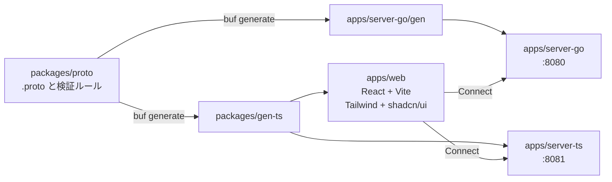

# connect-rpc

ConnectRPC を実案件で使えるか判断するためのサンプル。同じ proto から Go と TypeScript の 2 つのサーバーを作り、1 つの React クライアントから、どちらにも同じ API で呼べることを示す。

## 分かること

* **API の定義と検証ルールが proto だけにある。** 2 つのサーバーと web は、そこから生成したコードを使う。検証コードを手で書かない
* **Go と TS で振る舞いが同じ。** 起動中の両サーバーに同じテスト（[契約テスト](docs/development.md#契約テスト)）を流して確かめている
* **実案件で必要になる周辺も、動くコードで見られる。** エラー、ページング、タイムアウト、Server streaming、ログなど（下の表）
* **実装していないことも書いてある。** 何が足りないかは [docs/production.md](docs/production.md) にまとめた

> 現在の API は連絡先（Contact）の CRUD と、変更を監視する Server streaming（WatchContacts）。保存先はサーバーのメモリで、再起動すると消える。本番運用は想定していない

## 構成



| ディレクトリ | 役割 |
|---|---|
| [packages/proto](packages/proto) | `.proto` と buf の設定（API の唯一の正） |
| [packages/gen-ts](packages/gen-ts) | TS の生成コード（web と server-ts が共有） |
| [packages/contract-test](packages/contract-test) | 起動中の Go / TS サーバーに同じテストを流す |
| [apps/web](apps/web) | React + Vite のクライアント（見た目は Tailwind CSS と shadcn/ui）。接続先は環境変数で切り替える |
| [apps/server-go](apps/server-go) | Go のサーバー（`connectrpc.com/connect/v2`） |
| [apps/server-ts](apps/server-ts) | TypeScript（Node）のサーバー（`@connectrpc/connect-node`） |

## 見られること

API は [contact.proto](packages/proto/proto/contact/v1/contact.proto)（`contact.v1.ContactService`）。

| テーマ | 内容 | 詳しく |
|---|---|---|
| 検証 | protovalidate のルールを、ブラウザと両サーバーが同じ形で実行する。日本語のメッセージも proto に置く | [validation.md](docs/validation.md) |
| エラー | 検証失敗も重複も同じ `Violations` で届き、web は 1 つの処理で入力欄に出す | [validation.md](docs/validation.md#エラー) |
| GET | 読み取り専用の RPC を `NO_SIDE_EFFECTS` にして、GET で呼ぶ | [rpc-features.md](docs/rpc-features.md#get-で呼ぶ) |
| ページング | `page_size` / `page_token`（AIP-158 の形）。めくる途中の削除でも飛ばない | [rpc-features.md](docs/rpc-features.md#ページング) |
| タイムアウト | 期限がサーバーに伝わり、ハンドラが守る | [rpc-features.md](docs/rpc-features.md#タイムアウト) |
| 想定外のエラー | 内容を隠して `internal` にし、原因をログに残す | [rpc-features.md](docs/rpc-features.md#想定外のエラー) |
| Server streaming | 接続直後に snapshot、その後は change。画面では変更の通知に使う | [streaming.md](docs/streaming.md) |
| ログ | 1 RPC 1 行のアクセスログと `request_id`。Go と TS で形式をそろえる | [logging.md](docs/logging.md) |
| プロトコル | 同じハンドラが Connect・gRPC-Web を受ける。gRPC は h2c が要り、このサンプルは未設定。平文の h2c は Go なら 1 ポートで全部通るが、TS は TLS が要る（実測） | [protocols.md](docs/protocols.md) |

画面は、連絡先の一覧と追加・編集・削除、1 件の詳細、「サーバーの変更」欄（別のタブの変更の通知）で構成している。web の「送信前の検証をスキップ」をオンにすると、ブラウザの検証を通さずにサーバーの検証を試せる。

## 動かす

bun と Docker が要る。手順の詳細は [docs/development.md](docs/development.md)。

```bash
bun install

# サーバーを両方起動（Go: 8080、TS: 8081）
docker compose up -d --build --wait

# クライアント（接続先は VITE_API_URL。省略すると Go）
bun run --filter @connect-rpc/web dev
VITE_API_URL=http://localhost:8081 bun run --filter @connect-rpc/web dev

# テスト（契約テストは、先にサーバーを起動しておく）
bun run test:unit
bun run test:go
bun run test:contract
```

## 使っている版と注意

* **connect-go は v2（`connectrpc.com/connect/v2`）を使っている。** ネット上の記事の多くは v1 の書き方なので、読み替えが要る。このコードに出てくる違い
  * サーバーは `connect.NewServer(interceptors...)` で作り、`contactv1connect.RegisterContactServiceHandler(server, impl)` でサービスを登録し、`connecthttp.Mount(mux, server)` で `http.ServeMux` につなぐ（v1 の記事では、`NewContactServiceHandler` が返す path と handler を mux に登録する書き方が多い）
  * interceptor は `func(next connect.ServerFunc) connect.ServerFunc` の形で、Unary もストリームも同じ 1 つで包める（[accesslog.go](apps/server-go/accesslog.go)）
* TS は connect-es v2 と protobuf-es v2。サーバーは Node の型除去で `.ts` をそのまま実行する（ビルドしない）

## Go と TS の違い

同じ API でも、実装には差がある。差は各ドキュメントに書いてある。

* 遅い watch 購読者の扱い（Go は切る、TS は上限なし）: [streaming.md](docs/streaming.md#go-と-ts-の違い)
* メッセージサイズの既定の上限（Go は 4 MiB、TS は実質なし）: [production.md](docs/production.md#サーバーの設定)
* ログの `time`（Go はマシンのタイムゾーン、TS は UTC）: [logging.md](docs/logging.md#制限)

## 実案件に持ち込むとき

[docs/production.md](docs/production.md) に、実案件で考えること（サーバーの設定、プロキシ越しの streaming、冪等性など）と、このサンプルで実装していないこと（認証、部分更新、OpenAPI の生成、OpenTelemetry など）をまとめてある。
