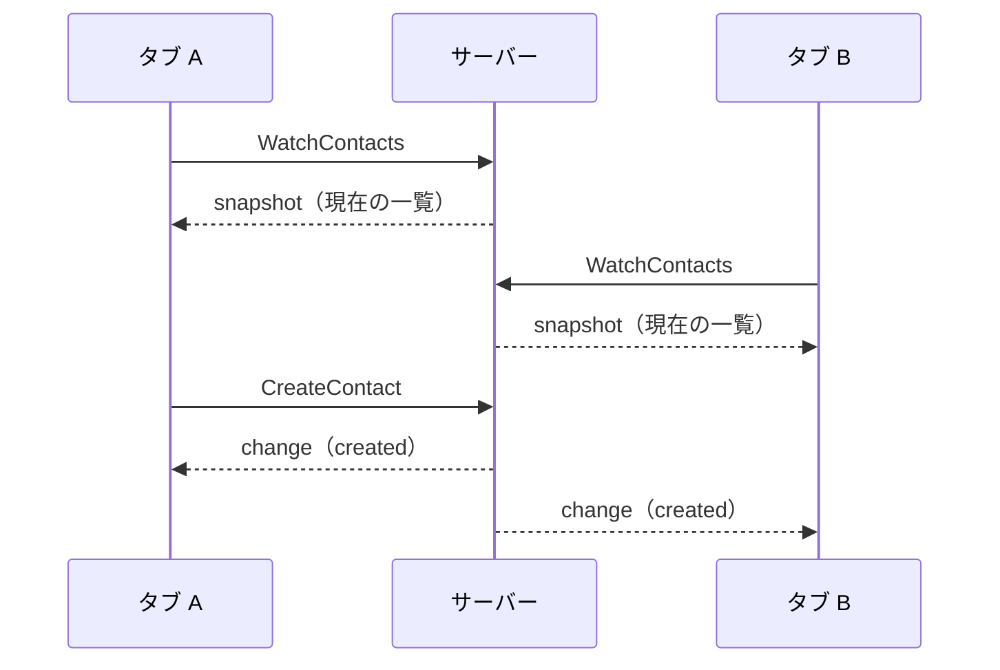

# Server streaming（WatchContacts）

連絡先の変更を監視する。別のタブで追加・更新・削除すると、開いているタブの「サーバーの変更」欄にすぐ届く。

## 画面での使い方

* **一覧は `ListContacts` で作る。** 画面を開いたときに全件を取り、自分の追加・更新・削除は、RPC の応答で一覧に反映する。watch がつながっていなくても、自分の操作は正しく反映される
* **watch は変更の通知にする。** 「サーバーの変更」欄に、`change` を新しい順に最大 10 件出す（[ChangeFeed.tsx](../apps/web/src/ChangeFeed.tsx)）。自分のタブの操作も届く（クライアントを区別する仕組みがないため）。別のタブの変更を一覧に入れたいときは、「一覧を再読み込み」を押す
* watch だけで一覧を作る形もある（`snapshot` で置き換え、`change` を差分で当てる）。再接続で状態が自然に直る一方、切れている間は一覧が止まる。このサンプルは、watch の役割を分かりやすくするため、通知にしている

## 仕様

* 接続した直後に現在の一覧（`snapshot`）を 1 回送り、その後は変更（`change`: created / updated / deleted）を起きた順に送る。一覧と購読の登録を同時に行うので、取りこぼしが出ない。削除では、削除する前の Contact が届く
* クライアントが切断・中止すると、サーバーは購読を外す。サーバーが期限を指定されたときは、期限が来たところで `deadline_exceeded` で終える
* 保存先がメモリなので、サーバーを再起動すると一覧が空になる（再接続後の `snapshot` は空）

## web の再接続

* 切れたら web は 2 秒後に再接続する（[watchContacts.ts](../apps/web/src/watchContacts.ts)）。つながり直すと `snapshot` が来るので、通知欄に「接続しました」と出る
* 間隔は固定なので、サーバーが落ちている間は全クライアントが 2 秒ごとに再接続する。実際のアプリでは、間隔を伸ばしていき（バックオフ）、ランダムなずれ（ジッター）を入れる
* web の既定の期限（`defaultTimeoutMs`）は 10 秒で、そのままだと watch が切れる。watch の呼び出しだけ `timeoutMs: 0`（期限なし）にしている。connect-es の transport は、呼び出しの `timeoutMs` が 0 以下なら既定の期限を使わない
* このサンプルはハートビートを送らない。間にプロキシやロードバランサーがあると、変更のない接続がアイドルとして切られることがある。切れても再接続で戻る。切られたくなければ、サーバーが定期的にメッセージを送る（proto に、ハートビート用のイベントを足す）か、プロキシのアイドル時間を延ばす

## Go と TS の違い

* 遅い購読者の扱いが違う。Go は購読者ごとに 64 件までバッファし、いっぱいになったら `resource_exhausted` で切る（変更を発行する側を待たせないため）。TS は `node:events` の `on()` を使うので、上限がない
* TS の `accessLog` と `maskErrors` は、応答のストリームを包んで、終わりと途中のエラーを拾う。Go は `ServerFunc` がそのままストリーム全体を囲むので、何もしなくてよい

## HTTP/1.1 と HTTP/2

* ブラウザは、HTTP/1.1 では同じホストへの同時接続が 6 本まで。watch は 1 本を占有するので、同じサーバーを開くタブが多いと、他の呼び出しが待たされる。HTTP/2 なら出ない
* このサンプルは HTTP/1.1 で動かしている。**ブラウザが HTTP/2 を使うのは TLS（https）のときだけ** で、平文の HTTP/2（h2c）にはブラウザが対応していない。6 本の制限を避けるには、TLS を終端するプロキシ（またはサーバー自身の TLS）が要る。h2c は、プロキシの裏側や gRPC のクライアントとの通信で使うもので、ブラウザには効かない（[protocols.md](protocols.md#grpc-を受けるh2c)）
* ブラウザでの Server streaming は、Connect プロトコル（と gRPC-Web）で動く。双方向ストリーミングは使えない（[production.md](production.md#未実装のこと)）
