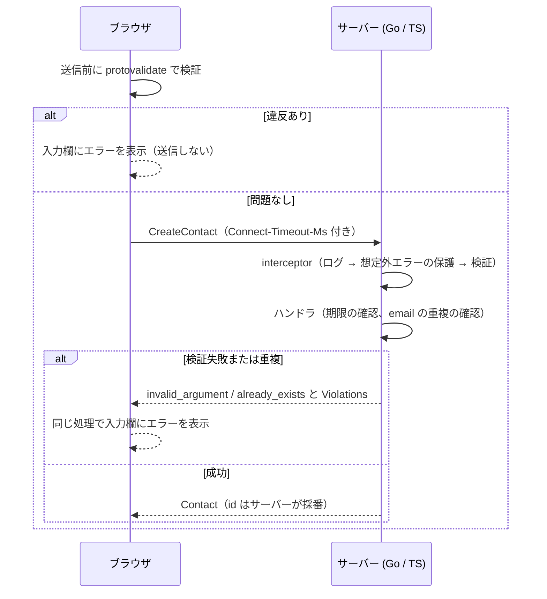

# 検証とエラー

ルールは [contact.proto](../packages/proto/proto/contact/v1/contact.proto) に [protovalidate](https://protovalidate.com) のアノテーションで書く。Go・TS のサーバーは interceptor で、web は送信前に同じルールを実行する。検証コードを手で書かない

## ルールのパターン

| パターン | 例（`Contact`） |
|---|---|
| 標準ルール | `name` と `email` と `category` の必須、`email` の形式、`category` が定義済みの値、`id` の UUID |
| 任意項目の条件付き | `phone` は空なら検証せず、入力があるときだけ形式を見る（`IGNORE_IF_ZERO_VALUE`） |
| 独自ルール（CEL） | `name` は空白だけを許さない |
| 数値を含むルール（CEL） | `name` は 50 文字以内、`message` は 500 文字以内、`phone` は 0 始まりの 10〜11 桁 |
| フィールド間のルール（CEL） | `category` が「その他」のとき `message` は必須 |
| サーバーだけの業務ルール | `email` の重複（大文字小文字を区別しない） |

## メッセージを proto に置く

標準ルール（`max_len` や `pattern`）は、メッセージを proto で差し替えられない。メッセージは英語で、数値も入っている。そこで、メッセージに数値を含むルールは CEL で書き、日本語のメッセージを proto に置く。

```proto
string message = 6 [(buf.validate.field).cel = {
  id: "contact.message_max_len"
  message: "500 文字以内で入力してください"
  expression: "this.size() <= 500"
}];
```

* ブラウザもサーバーも、この `message` をそのまま返す。ルールの値（500）とメッセージが同じ場所にあるので、片方だけ変えて食い違うことがない
* 標準ルールのままにしたもの（`required`、`string.email`、`enum.defined_only`）は、web が `ruleId` から日本語にする（[fieldErrors.ts](../apps/web/src/fieldErrors.ts)）。数値を含まないので、表に複製してもずれない
* CEL にすると、`ruleId` は自分で付けた名前（`contact.name_max_len`）になる。標準ルールなら `string.max_len` のように、ルールの種類が `ruleId` から分かる。そこが引き換え
* CEL の `size()` は文字数（コードポイント）を数える。`max_len` と同じ数え方で、「あ」を 50 個並べた名前は通り、51 個で違反になる（契約テストで確認している）

## 呼び出しの流れ



web の「送信前の検証をスキップ」をオンにすると、ブラウザの検証を通さずに、サーバーの検証を試せる。

## エラー

| 状況 | Connect のコード |
|---|---|
| 検証失敗 | `invalid_argument`（details に違反の一覧 `buf.validate.Violations`） |
| `email` の重複 | `already_exists`（details は検証失敗と同じ `Violations`） |
| 存在しない ID | `not_found` |

重複も検証失敗と同じ型で届くので、web は 1 つの処理（[fieldErrors.ts](../apps/web/src/fieldErrors.ts)）で入力欄ごとのエラーにできる。ブラウザの検証の結果（`@bufbuild/protovalidate`）も、同じ形に変換して同じ処理に渡す。

## 確認していること

[契約テスト](development.md#契約テスト)で、検証パターンごとに Go と TS が同じ違反（フィールドと `ruleId`）を返すこと、ブラウザの検証器も同じ結果になることを確認している。
